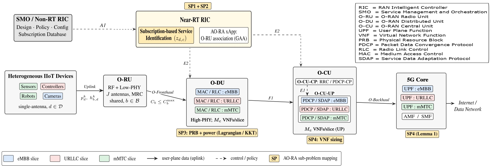

# AO-RA: Alternating Optimization for Resource Allocation in Heterogeneous IIoT Services over O-RAN Networks

Reference implementation and simulation code for the paper:

> R. Khadhraoui, L. Ferdouse, and L. Nasraoui, "Alternating Optimization for
> Resource Allocation in Heterogeneous IIoT Services over O-RAN Networks,"
> submitted to IEEE Internet of Things Journal, 2026.

AO-RA is a unified **Alternating Optimization-based Resource Allocation**
framework for uplink resource allocation in massive IIoT-enabled O-RAN
networks. The Near-RT RIC identifies the service class of each IIoT device
(eMBB, URLLC, or mMTC) at registration time via a subscription-based
mechanism, and the joint O-RU association, PRB assignment, transmit power
control, and VNF sizing problem (an MINLP) is decomposed into four
sub-problems, each mapped to its native O-RAN functional entity:

| Sub-problem | O-RAN node    | Variable           | Method                                                   |
|-------------|---------------|--------------------|----------------------------------------------------------|
| SP1         | Near-RT RIC   | `z_{d,c}`          | Subscription-based (fixed)                               |
| SP2         | Near-RT RIC   | `x_{b,d}`          | Load-aware Greedy Assignment Algorithm (GAA)             |
| SP3         | O-DU          | `a_{b,d}^k, p_d^k` | Dual-guided greedy PRB assignment + KKT threshold power  |
| SP4         | O-CU-UP / UPF | `M_c`              | Closed form (Lemma 1)                                    |

## System architecture



## How it works

IIoT devices (sensors, robots, controllers, cameras) transmit uplink
data through a shared O-RU to per-slice VNF chains at the O-DU,
O-CU-UP, and UPF. The AO-RA framework decomposes the joint resource
allocation problem into four sub-problems, each executed at its native
O-RAN entity:

1. **SP1 — Service identification (Near-RT RIC):** each device's
   service class (eMBB / URLLC / mMTC) is retrieved once from the
   subscription database and fixed before optimization — no online
   inference.
2. **SP2 — O-RU association (Near-RT RIC):** a load-aware Greedy
   Assignment Algorithm (GAA) assigns each device to an O-RU under
   the fronthaul capacity constraint, using channel statistics only.
3. **SP3 — PRB and power allocation (O-DU):** a dual-guided greedy rule
   assigns PRBs (exclusive per O-RU, at most 3 PRBs per device), and the
   KKT analysis yields a threshold (on/off) power policy at `P_max`,
   while enforcing per-class rate and delay bounds.
4. **SP4 — VNF sizing (O-CU-UP/UPF):** the minimum number of VNF
   instances per slice is computed in closed form (Lemma 1) to meet
   each slice's end-to-end delay budget.

SP3 → SP4 → SP2 alternate cyclically. The weighted sum rate is not
guaranteed to be monotone across outer iterations, so the algorithm
stores and returns the **best iterate** (a termination guarantee, not an
optimality guarantee). In practice the stopping rule triggers after
2.45–2.95 outer iterations on average.

### Scope of the model

Results are obtained in a **noise-limited uplink model** (PRB exclusivity
removes intra-cell interference; inter-cell interference is neglected in the
optimization). The effect of inter-cell interference is evaluated a posteriori
(see below). The path loss follows `d^-α` with no reference-distance term, so
absolute SNRs and rates are optimistic and should be read as relative
indicators. See the Limitations section of the paper for details.

## What is new in the revised version (v2.0)

- Interference-free SNR model; threshold (on/off) power policy and
  dual-guided greedy PRB rule described as implemented.
- Per-PRB rates `r_d^k` and total device rate `R_d` made explicit.
- Best-iterate convergence statement, with sensitivity tests on `I_max`,
  `ε` and `α_0`.
- Statistical significance analysis of AO-RA vs. DR (bootstrap CIs, Wilcoxon).
- Packet-level latency analysis (serialization, propagation) and packet-level
  VNF sizing.
- A posteriori evaluation of inter-cell interference.
- Component-wise ablation, slice-partition benchmark, VNF-sizing ablation.
- Preliminary evaluation of dynamic service labels.
- Measured runtime and Near-RT RIC feasibility discussion.

The full list is in [CHANGELOG.md](CHANGELOG.md).

## Repository structure

```
.
├── ao_ra.py                  # Core implementation: parameters (Table IV),
│                             # rate/SNR models, SP1–SP4, AO-RA (Algorithm 2),
│                             # Baseline & DR benchmarks, Monte Carlo, plotting
├── generate_figures.py       # Reproduces Figs. 2–6 of the paper
├── verify_constraints.py     # Per-device constraint verification tables
│                             # (C1, C4, C5 per device; C8 per O-RU)
├── convergence_sweep.py      # Sensitivity to I_max, ε, α_0 (Sec. VI-C, Table V)
├── significance.py           # AO-RA vs. DR statistics (Sec. VI-D, Table VI)
├── delay_components.py       # Packet-level latency analysis (Sec. VI-H, Fig. 7)
├── intercell_interference.py # Inter-cell interference evaluation (Sec. VI-I, Fig. 8a)
├── intercell_ranking.py      # Scheme ranking under interference (Sec. VI-I, Fig. 8b)
├── ablation.py               # Component-wise ablation + slice-partition benchmark
│                             # (Sec. VI-J, Fig. 9)
├── vnf_ablation.py           # VNF-sizing ablation (Sec. VI-J, Table VII)
├── check_duals.py            # Dual-variable check (Remark 1, Sec. VI-J)
├── dynamic_labels.py         # Dynamic service labels (Sec. VI-K, Table VIII)
├── runtime_benchmark.py      # Runtime measurement (Sec. VI-L, Table IX)
├── requirements.txt
├── CITATION.cff
├── CHANGELOG.md
├── LICENSE
├── docs/                     # Architecture diagram
└── results/                  # Generated figures and cached Monte Carlo data
```

## Installation

Requires Python ≥ 3.9.

```bash
git clone https://github.com/rouakhadhraoui/AO-RA-IIoT-ORAN.git
cd AO-RA-IIoT-ORAN
pip install -r requirements.txt
```

To obtain the code of a specific version:

```bash
git checkout v1.0-submitted   # original submission
git checkout v2.0-revision    # revised manuscript
```

## Reproducing the paper figures

```bash
# Full reproduction (100 Monte Carlo realizations per configuration).
# Results are cached in results/mc_results.npy after the first run.
python generate_figures.py

# Force a full re-run of the Monte Carlo experiment
python generate_figures.py --force

# Quick smoke test (few runs; numbers will NOT match the paper)
python generate_figures.py --quick
```

Outputs are written to `results/` as both PDF (submission quality, 300 dpi)
and PNG:

| File                        | Paper figure | Content                                        |
|-----------------------------|--------------|------------------------------------------------|
| `fig1_convergence`          | Fig. 2       | Weighted sum rate vs. outer AO iterations      |
| `fig2_utility_vs_D`         | Fig. 3       | Weighted sum rate vs. number of devices        |
| `fig5_oru_load`             | Fig. 4       | O-RU load distribution (D = 27)                |
| `fig3_delay_vs_lambda`      | Fig. 5       | URLLC end-to-end delay vs. arrival rate        |
| `fig4_utility_vs_power`     | Fig. 6       | Weighted sum rate vs. max transmit power       |

Note: paper Fig. 1 is the system architecture diagram (see above) and is
not generated by this script.

**Note:** full reproduction takes on the order of a few hours on a laptop
(the implementation is pure NumPy for readability; the dominant cost is the
`fig3_delay_vs_lambda` sweep, corresponding to paper Fig. 5). The `--quick`
flag is provided for validating the pipeline end-to-end in a few minutes.

## Additional analyses (revised manuscript)

Each script reproduces one analysis added in the revision. Run it with
`python <script>.py`.

| Script                      | Paper section  | Output                                                       |
|-----------------------------|----------------|--------------------------------------------------------------|
| `convergence_sweep.py`      | VI-C           | Table V: sensitivity to `I_max`, `ε`, `α_0`                  |
| `significance.py`           | VI-D           | Table VI: gain over DR, bootstrap 95% CI, Wilcoxon tests     |
| `delay_components.py`       | VI-H           | Fig. 7 (`fig_delay_components`): latency components          |
| `intercell_interference.py` | VI-I           | Fig. 8(a) (`fig_intercell`): noise-limited vs. interference  |
| `intercell_ranking.py`      | VI-I           | Fig. 8(b): AO-RA, DR and Baseline under interference         |
| `ablation.py`               | VI-J           | Fig. 9 (`fig_ablation`): component-wise ablation             |
| `vnf_ablation.py`           | VI-J           | Table VII: VNF-sizing ablation                               |
| `check_duals.py`            | VI-J, Remark 1 | Values of the dual variables for each `D`                    |
| `dynamic_labels.py`         | VI-K           | Table VIII: effect of service-label changes                  |
| `runtime_benchmark.py`      | VI-L           | Table IX: measured runtime per sub-problem                   |

The runtimes in the paper were measured in single-threaded Python 3.14 with
NumPy 2.4 on an Intel Core i7-11800H (16 GB RAM, Windows 10). Absolute
timings depend on the machine; the relative breakdown (SP3 dominating the
total) should be reproducible.

## Constraint verification

Per-device satisfaction of the paper's constraints (C1 power cap, C4 minimum
rate, C5 end-to-end delay, C8 fronthaul capacity, plus starvation and PRB
distribution checks) can be regenerated with:

```bash
python verify_constraints.py            # D = 9 and D = 27 (default)
python verify_constraints.py -D 18 36   # custom device counts
```

Each run prints the full table and exports it to `AO_RA_debug_D<D>.xlsx`.
For the deterministic seed used in the paper (42), all configurations show
**zero constraint violations and zero starved devices**.

## Reproducibility

- All randomness is controlled by explicit, deterministic seeds:
  Monte Carlo realization *n* for device count *D* uses seed
  `n·1000 + D`, so every realization can be regenerated independently.
- Realizations are drawn until 100 pass a necessary-condition feasibility
  pre-check and leave no device unserved by AO-RA (see `run_monte_carlo`
  in `ao_ra.py`). The discard rate is 0%, 0%, 1% and 28.1% for
  `D = 9, 18, 27, 36`, as reported in the Limitations section of the paper.
- Simulation parameters exactly match Table IV of the paper and are defined
  at the top of `ao_ra.py` (noise PSD −174 dBm/Hz, `N_0` = PSD × `B_w`).
- The paired comparisons (AO-RA vs. DR, ablation variants) use the same
  seeds across schemes.

## Requirements

- `numpy`
- `scipy` (statistical tests)
- `pandas`
- `matplotlib`
- `openpyxl` (Excel export in `verify_constraints.py`)

## Status

This code accompanies the revised manuscript submitted to the
IEEE Internet of Things Journal.

- `v1.0-submitted`: code corresponding to the original submission.
- `v2.0-revision`: code corresponding to the revised manuscript (current `main`).

## Affiliation

This work was developed within the
[SMART-Net-Lab-Projects](https://github.com/SMART-Net-Lab-Projects)
(SMART-Net Lab), Wilfrid Laurier University, Waterloo, ON, Canada.

## Citation

If you use this code, please cite:

```bibtex
@misc{aora_code_2026,
  author       = {Khadhraoui, Roua and Ferdouse, Lilatul and Nasraoui, Le{\"i}la},
  title        = {{AO-RA}: Alternating Optimization for Resource Allocation
                  in Heterogeneous {IIoT} Services over {O-RAN} Networks
                  --- Reference Implementation},
  year         = {2026},
  howpublished = {\url{https://github.com/rouakhadhraoui/AO-RA-IIoT-ORAN}},
  note         = {Source code, version 2.0, accessed Oct. 2026}
}
```

The journal paper citation will be added once accepted.

## License

This project is released under the MIT License. See [LICENSE](LICENSE).